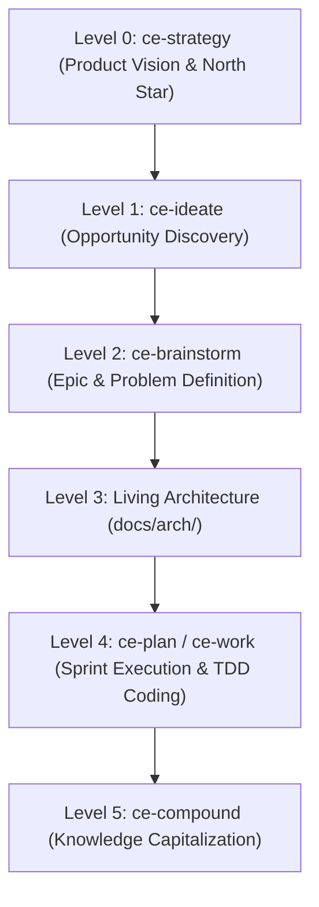
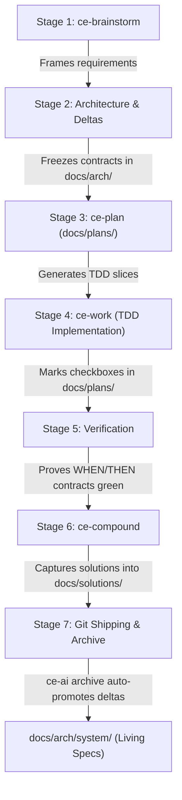
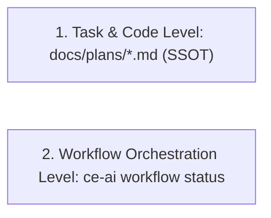

<!-- Diátaxis Quadrant: Explanation | Audience: Beginner -->
# 🎓 Compound Engineering Workflow: From Strategy to Code

Welcome! If you are new to **Compound Engineering** and **`ce-ai`**, this guide will explain how the entire development flywheel works — from high-level product strategy all the way to individual lines of code and durable team knowledge.

---

## 1. The Big Picture: The 6-Level Product & Engineering Hierarchy

A common point of confusion for newcomers is understanding how slash commands like `/ce-strategy`, `/ce-ideate`, `/ce-brainstorm`, `/ce-plan`, `/ce-work`, `/ce-compound`, and **OpenSpec** fit together without duplicating effort.

Think of it as a **6-level product management and software engineering funnel**:

---

## 2. Everyday Analogy: The Agile Product Funnel

If you are familiar with Agile software development, each level in Compound Engineering maps directly to a standard product role:

| Level | `ce-ai` Tool / Artifact | Agile & Product Analogy | Key Question Answered | Output / Deliverable |
| :---: | :--- | :--- | :--- | :--- |
| **Level 0** | **`ce-strategy`** | **Product Vision & OKRs** | *"Where is the product heading over the next 6–12 months?"* | `STRATEGY.md` / `ROADMAP.md` |
| **Level 1** | **`ce-ideate`** | **Opportunity Discovery** | *"What options or improvements could we explore?"* | 3–5 evaluated alternatives |
| **Level 2** | **`ce-brainstorm`** | **Epic & Problem Definition** | *"Which option did we pick, and what is the scope of this Epic?"* | `docs/brainstorms/` |
| **Level 3** | **Living Architecture** | **Architecture & Contracts** | *"What are the exact formal rules (`WHEN..THEN`) and API contracts?"* | `docs/arch/system/` or `docs/arch/deltas/` |
| **Level 4** | **`ce-plan` / `ce-work`** | **Sprint Backlog & Coding** | *"How do we write code and pass atomic tests (Red-Green-Refactor)?"* | `docs/plans/` + TDD Tests |
| **Level 5** | **`ce-compound`** | **Retrospective & Knowledge Base** | *"What did we learn so the team never has to re-investigate this?"* | `docs/solutions/` |

---

## 3. Deep-Dive: Each Stage Explained for Newbies

### 🎯 Level 0: `ce-strategy` (Product Vision & North Star)
- **Role**: Defines the overarching goals, architectural principles, and long-term roadmap.
- **Why it matters**: Prevents the team or AI agents from spending energy building features that do not align with the product's direction.

### 💡 Level 1: `ce-ideate` (Opportunity Discovery)
- **Role**: Divergent thinking. Generates and compares multiple potential solutions (1 to N options) before committing to one.
- **Why it matters**: Avoids jumping to the first obvious solution. Explores tradeoffs, performance implications, and alternatives early.
- **Related, not the same tool — `ce-pov`**: `ce-ideate` is divergent (many candidate directions, none named yet). `ce-pov` is convergent: you already have one specific external candidate in mind — a library, framework, or architectural pattern — and want a decisive, project-grounded yes/no on it, not a list of alternatives. It's also the right tool mid-session when an external event (a CVE, a deprecation, an ecosystem shift) lands and you need to know whether it actually affects *this* project. A "yes" verdict from `ce-pov` feeds into `ce-brainstorm` exactly like a chosen idea from `ce-ideate` would.

### 🔍 Level 2: `ce-brainstorm` (Epic & Problem Definition)
- **Role**: Convergent thinking. Takes the chosen idea and frames the problem in depth.
- **Why it matters**: Clarifies user intent, identifies edge cases, and outlines the broad technical approach before writing any formal specifications.

### 📐 Level 3: Living Architecture & Contracts (`docs/arch/`)
A common beginner question is: *"Why do we need architecture specifications if we already did a brainstorm?"*
- **The Difference**:
  - `ce-brainstorm` is **narrative and conversational** (the story of why and how options were evaluated).
  - Living Architecture is **contractual, durable, and testable**. It formalizes core requirements under `docs/arch/`:
    - `docs/arch/system/<domain>.md`: Living domain specifications aggregating capabilities across features.
    - `docs/arch/adr/NNNN-<slug>.md`: Architecture Decision Records capturing irreversible architectural choices.
    - `docs/arch/contracts/`: Formal interface schemas and protocol contracts.
    - `docs/arch/deltas/<feature>/`: Temporary delta packages during development, auto-promoted to system specs upon archive.

### ⚡ Level 4: `ce-plan` & `ce-work` (Sprint Backlog & TDD Execution)
- **Where does `/ce-plan` fit relative to Architecture?**
  - **`/ce-plan` creates the executable implementation plan in `docs/plans/`.**
  - `/ce-plan` organizes the build into vertical Scrum slices with explicit TDD test triads (red-green-refactor) and changed-line targets (~200 LOC).
  - Checkboxes (`- [x]`) in `docs/plans/` serve as the single source of truth for task progress, freeing developers from redundant task packages.
- **`/ce-work` Execution Loop**:
  - Reads `docs/plans/`, executes TDD (Red-Green-Refactor), and marks checkboxes (`- [x] Unit 1`).
  - **Bounded Work Units**: Executes in bounded slices (~200 changed LOC heuristic) verified by local build tools (`cargo test`, `make e2e`).

---

## 🔄 4. Living Architecture Accretion

Living Architecture is **not static documentation written once**. It is an **accreting domain tree (`docs/arch/`) that evolves progressively across Compound Engineering stages**:

| Lifecycle Phase | Active Agent / Command | Files Added / Updated in `docs/arch/` & `docs/plans/` |
| :--- | :--- | :--- |
| **Ideation & Framing** | `ce-brainstorm` | Produces framing in `docs/brainstorms/` |
| **Architecture** | Architectural Definition | Living specs in `docs/arch/system/` or deltas in `docs/arch/deltas/<feature>/` |
| **Planning** | `ce-plan` | Implementation plan in `docs/plans/` with TDD checklist |
| **Development** | `ce-work` | Updates `docs/plans/` (`- [x]`) and executes red-green-refactor code |
| **Verification** | Project test suite, linters & E2E gates | Proves every WHEN/THEN requirement green before shipping |
| **Capitalization** | `ce-compound` | Consolidates learnings into permanent `docs/solutions/` and `CONCEPTS.md` |
| **Archive** | `ce-ai archive` | Moves deltas to `docs/arch/archive/` and auto-promotes requirements to living specs |

---

## 📊 5. How Do I Track Progress?

Newcomers often ask: *"Where do I check the progress of my feature?"*

Progress is tracked at **two complementary levels**:

1. **Granular Task & Code Progress**: Followed directly in the implementation plan under `docs/plans/*.md` (or active delta package). As `ce-work` completes TDD units, checkboxes are marked `- [x]`. `ce-ai` treats `docs/plans/` as the definitive Single Source of Truth for progress.
2. **High-Level Workflow Progress**: Followed using `ce-ai workflow status` (or `ce-ai status`), showing which of the 7 stages the project is currently executing.
