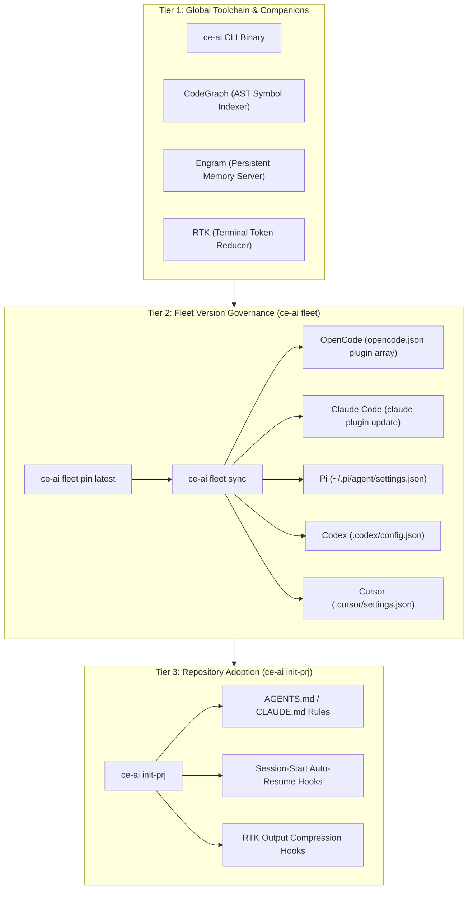

# Step-by-Step Guide: Installation Pipeline and Coexistence with Official Harnesses

This guide explains step-by-step how `ce-ai` installs the **Compound Engineering Plugin** and how it coexists safely with official configurations and setups of tools like **Claude Code**, **OpenCode**, **Cursor**, **GitHub Copilot**, and others.

---

## 💡 Key Concepts & Terminology (Read This First!)

Before reading the installation steps, here are simple explanations for key terms and files used throughout this guide:

### What is `install-manifest.json` and Where Does it Come From?
**`install-manifest.json`** is a digital fingerprint ledger automatically created by `ce-ai` inside each harness's managed folder during installation (`ce-ai install`).
- *Where it lives*: `~/.config/opencode/compound-engineering/install-manifest.json` (or target harness managed directory).
- *What it contains*:
  1. **Version & Source Tag**: Records whether the plugin was installed from GitHub release `vX.Y.Z` or a local development directory.
  2. **SHA256 File Hashes**: An index of cryptographic checksums for every installed skill and loader script.
  3. **Backup Pointer**: A record pointing to the exact timestamped backup of your original pre-install configuration file (e.g., `~/.ce-ai/backups/2026-08-21T12-00-00/claude.json`).

### What is `state.json`?
**`state.json`** is `ce-ai`'s central management state file located at `~/.ce-ai/state.json`. It keeps track of all installed harnesses on your machine, their active versions, last sync timestamps, and agent model assignments (`ce-brainstorm`, `ce-plan`, etc.).

### What is an Automatic Pre-Mutation Backup?
Before `ce-ai` makes any changes to your AI tools' configuration files (like `.claude.json` or `opencode.json`), it creates an exact, timestamped copy of your existing file under `~/.ce-ai/backups/`. On uninstall, `ce-ai` uses the matching harness snapshot to restore the pre-install configuration.

### What is Non-Destructive Config Merging?
"Non-destructive" means `ce-ai` preserves unrelated custom settings, API keys, MCP servers, and official application plugins. It writes CE-managed entries and keeps a pre-install backup so uninstall can restore the exact prior configuration. A user entry that deliberately uses a CE companion name (for example `codegraph`) is temporarily replaced while CE is installed, then restored from that snapshot during uninstall.

---

## 1. Modern Installation & Coexistence Architecture

Rather than extracting raw tarballs into host directories (the legacy `ce-ai install` approach), `ce-ai` operates as a **cross-host operational companion** organized into three distinct tiers:



### 📋 Detailed Tier Breakdown

#### Tier 1: Global Toolchain & Companions
- **`ce-ai`**: Cross-host operational CLI that governs fleet version parity, project adoption, decision routing, and workflow observation.
- **`codegraph`**: Codebase AST symbol, call-graph, and blast-radius indexer. Generates the local `.codegraph/` index (`codegraph init`) and exposes `codegraph_explore` via MCP so agents query symbols without blind filesystem greps.
- **`engram`**: SQLite + FTS5 persistent memory server. Maintains architectural decisions, bug fixes, and user constraints across agent sessions and context compactions via `mem_save` and `mem_context`.
- **`rtk`**: Smart terminal output compressor. Intercepts verbose stdio streams (`cargo test`, `git status`, `docker`) to reduce token usage by 60%–90%.

Verify companion health at any time with `ce-ai tools status`.

#### Tier 2: Multi-Harness Fleet Governance (`ce-ai fleet`)
- Users pin the target Compound Engineering version declaratively: `ce-ai fleet pin latest` (or explicit tag `v3.30.5`).
- `ce-ai fleet sync` inspects detected coding agents and drives each host's **native package manager or configuration system** rather than scraping files:
  - **OpenCode**: updates plugin version array in `opencode.json`.
  - **Claude Code**: runs native `claude plugin update compound-engineering@compound-engineering-plugin -y`.
  - **Pi**: updates `compound_engineering_version` in `~/.pi/agent/settings.json`.
  - **Codex**: updates `compound_engineering_version` in `.codex/config.json`.
  - **Cursor**: updates `compound_engineering_version` in `.cursor/settings.json`.
- Auditing: `ce-ai fleet status` reports version parity across all hosts.

#### Tier 3: Repository Project Adoption (`ce-ai init-prj`)
- Writes non-destructive governance blocks into the repository (`AGENTS.md`, `CLAUDE.md`, `.cursor/rules/`).
- Wires session-start hooks so agents automatically recover git status and active tasks upon session launch.
- Automatically injects RTK token-reduction wrappers for supported CLI commands.
- Registers the repository in `~/.ce-ai/state.json` under `projects` so batch maintenance (`ce-ai init-prj --all` and `ce-ai doctor --fix --all-projects`) can keep entire fleets updated.

> ⚠️ **Legacy `ce-ai install` notice**: Direct tarball extraction via `ce-ai install` is deprecated in favor of `ce-ai init-prj` + `ce-ai fleet pin / sync`. If invoked, `ce-ai install` emits a deprecation advisory directing users to the modern fleet and adoption commands.

---

## 2. Coexistence with Official Harness Setups (Claude Code, Cursor, OpenCode, etc.)

`ce-ai` preserves unrelated user settings and native configuration. CE-owned companion keys may be updated during installation; the per-harness pre-install snapshot is restored on uninstall.

### 🤖 1. Coexistence in Claude Code (`.claude.json` / `~/.claude/`)
- **Strategy**: Safe JSON Config Merger (`ensure_plugin_and_skills`).
- **Coexistence Behavior**:
  - Parses the existing `.claude.json` file.
  - If the user has configured **MCP (Model Context Protocol) servers**, API keys, UI preferences, or official Anthropic / third-party plugins, `ce-ai` **preserves them completely intact**.
  - Merges or updates only the `"compound-engineering"` entry inside the plugin array and skill paths in `"skills"`.
  - Avoids duplicate entries if the plugin was previously registered.

### 💻 2. Coexistence in OpenCode (`~/.config/opencode/opencode.json`)
- **Strategy**: JSON Array Merger (`plugin` & `skills`).
- **Coexistence Behavior**:
  - Parses `opencode.json`.
  - Merges the `compound-engineering` plugin entry and skills paths while keeping all existing user-defined plugins and skills untouched.

### 🖱️ 3. Coexistence in Cursor (`.cursorrules` / `.cursor/rules/`)
- **Strategy**: Markdown Delimited Block Injection.
- **Coexistence Behavior**:
  - If `.cursorrules` already exists with custom user rules, `ce-ai` **does NOT delete or overwrite the file**.
  - Injects or updates Compound Engineering directives inside comment-delimited blocks:
    ```markdown
    <!-- CE-AI MANAGED BLOCK START -->
    ... (CE-AI managed rules) ...
    <!-- CE-AI MANAGED BLOCK END -->
    ```
  - Any custom rules placed above or below the managed block remain 100% untouched.

### 🐙 4. Coexistence in GitHub Copilot (`.github/copilot-instructions.md`)
- **Strategy**: Markdown Delimited Block Injection.
- **Coexistence Behavior**:
  - Preserves all pre-existing repository instructions and injects/updates Compound Engineering directives within HTML comment delimiters.

### 🔮 5. Coexistence in Pi, Kimi, Antigravity (AGY), Codex, Grok, Fx
- **Strategy**: Dedicated Native Harness Adapters.
- **Coexistence Behavior**:
  - Preserves existing key-value structures in each harness's respective native configuration files (`~/.pi/agent/skills/`, `~/.gemini/config/mcp_config.json`, `~/.kimi-code/mcp.json`, `~/.codex/config.toml`, `~/.grok/config.toml`, `~/.fx/mcp.json`).

### 📁 6. Workspace Scoping & Gitignore Isolation (`init-prj` & `--scope workspace`)
- **Strategy**: Sentinel-Bounded `.gitignore` Protection.
- **Artifact Boundary**:
  - `compound-engineering/`: Contains machine-local installation files and manifests (`install-manifest.json`) recording absolute local paths. `ce-ai` automatically ensures this directory is ignored inside the sentinel block in `.gitignore`.
  - `.ce-ai/skills-registry.json` & `.codegraph/`: Machine-local companion caches and indices, automatically ignored.
  - `AGENTS.md` / `CLAUDE.md` / `.cursor/rules/`: Shared team governance and directives; these **should be committed** to Git.
  - `opencode.json` / `.claude.json`: Native harness configs; can optionally be committed if sharing team-wide settings and MCP servers.

---

## 🛡️ Summary of Safety Guarantees

1. **Scoped Configuration Mutation**: CE writes only managed entries and preserves unrelated configuration.
2. **Clean Uninstallation (`ce-ai uninstall`)**: Uninstallation restores the original pre-install backup created in Step 2 when one exists, or removes CE-managed entries otherwise.
3. **Auditability**: Every change is tracked in `install-manifest.json` with per-file SHA256 hashes.
4. **Git Repository Cleanliness**: Machine-local workspace installations are automatically excluded via `.gitignore` sentinels.
