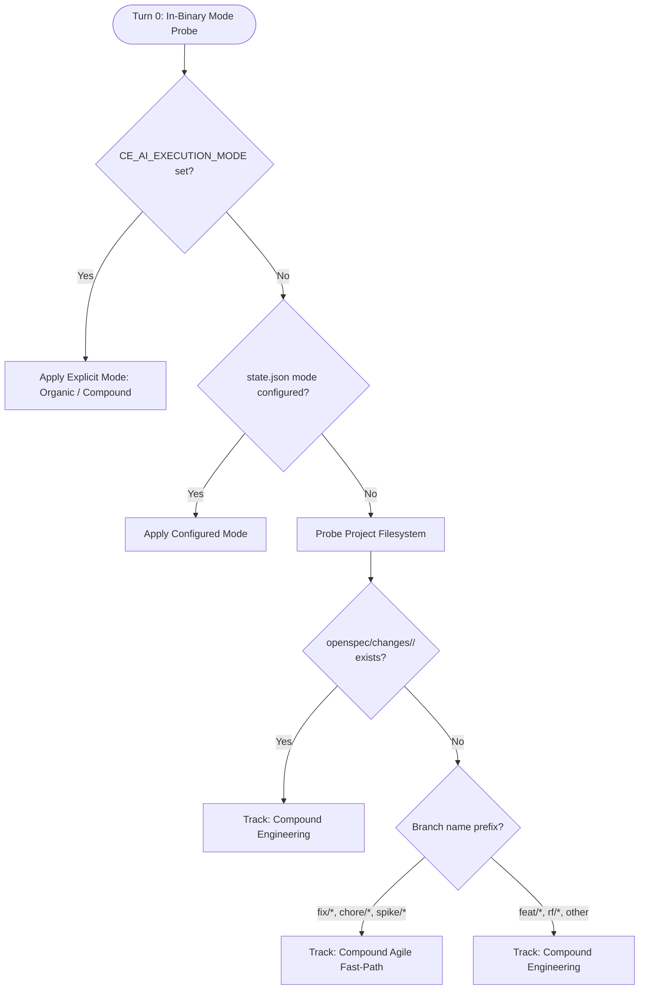
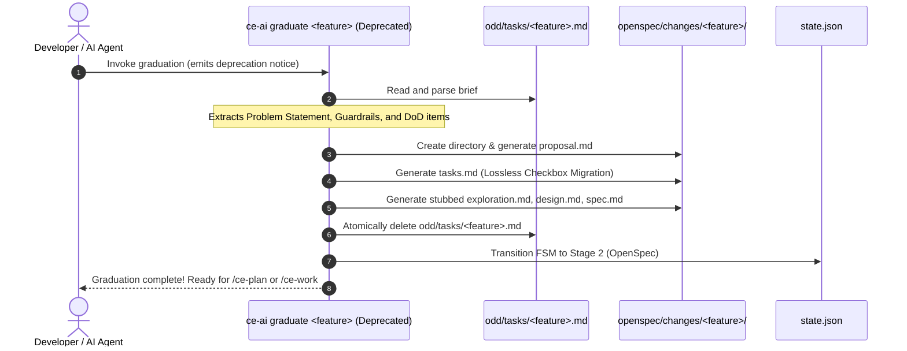
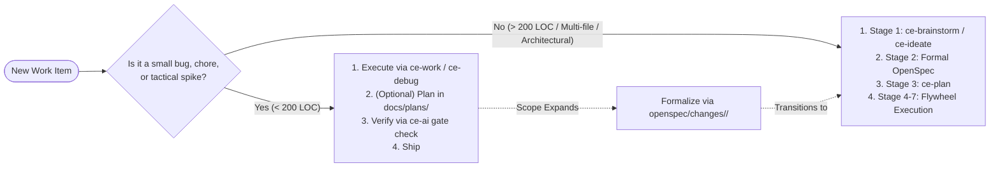

<!-- Diátaxis Quadrant: Explanation | Audience: Beginner / Senior -->
# 🎓 Masterclass: Compound Agile Fast-Path & The Migration from ODD

Welcome to this masterclass! Whether you are an engineer managing rapid bug fixes or a systems architect steering multi-quarter platform migrations, balancing **developer velocity** and **architectural rigor** is a central challenge in modern software engineering.

When working with autonomous AI coding agents, this tension becomes acute. AI agents move fast, but if left unguided they produce code without memory, tests, or architectural coherence. Conversely, forcing an AI agent through a 7-stage formal specification process for a 3-line configuration fix introduces unnecessary friction.

This guide explains how `ce-ai` harmonizes these two worlds with the **Compound Agile Fast-Path**—leveraging lightweight plans (`docs/plans/`), direct TDD (`ce-work`), and bug loops (`ce-debug`) alongside the formal 7-stage Compound Engineering Flywheel, while providing migration guidance for the decommissioned Organic Driven Development (ODD) subsystem and its deprecated graduation bridge.

---

## Attribution and Historical Context

Organic Driven Development (ODD) was originally created by [Alan Buscaglia](https://github.com/Alan-TheGentleman) through [Gentle AI](https://github.com/Gentleman-Programming/gentle-ai). CE-AI previously experimented with an isolated `odd/tasks/` file structure and a `graduate` bridge. In accordance with Invariant 6 (*No Semantic Authority*), CE-AI v3.5 decommissioned custom `odd/tasks/` file trees in favor of native Compound Engineering execution primitives (`docs/plans/`, `/ce-work`, `/ce-debug`). This preserves Alan Buscaglia's core insight—that tactical, understood work must remain light and unburdened by heavy ceremony—while operating directly on native Compound Engineering artifacts rather than proprietary file formats. See [CE-AI positioning](ce-ai-positioning.md) for the relationship among agents, the official Compound Engineering plugin, and CE-AI.

---

## 1. The Core Dilemma: Agility vs. Compound Intelligence

### 🚤 The Speedboat vs. The Aircraft Carrier

Consider two vessels navigating an ocean:

- **The Speedboat (Compound Agile Fast-Path)**: Nimble, lightweight, and capable of turning on a dime. Ideal for quick bug fixes, chores, and exploratory spikes. It requires minimal overhead: a clear problem statement, a few guardrails, and an actionable checklist in `docs/plans/` (or direct `/ce-work` / `/ce-debug` execution).
- **The Aircraft Carrier (Formal Compound Engineering Track)**: Massive, resilient, and equipped for sustained strategic operations. Designed for greenfield features, architectural refactors, and core platform enhancements. It is governed by a formal 7-stage Finite State Machine (FSM): Ideation, OpenSpec definition, planning, work/TDD, empirical verification, knowledge compounding, and shipping.

| Dimension | Compound Agile Fast-Path | Formal Compound Track |
| :--- | :--- | :--- |
| **Origin & Philosophy** | Lean agile execution (Alan Buscaglia / Gentle AI insight) | Compound Engineering (Formal, stage-gated, compounding) |
| **Primary Scope** | Bug fixes, chores, spikes, small tasks (< 200 LOC) | Greenfield features, multi-file refactors, architecture changes |
| **Artifact Footprint** | Lightweight plan in `docs/plans/` or direct execution | Full directory: `openspec/changes/<feature>/` (5 files) |
| **Lifecycle Model** | Direct execution (`probe ➔ execute ➔ gate`) | 7-stage FSM (`Ideation ➔ OpenSpec ➔ Plan ➔ Work ➔ Verify ➔ Compound ➔ Ship`) |
| **Knowledge Capture** | Optional / Engram session notes / targeted solution doc | Mandatory: `docs/solutions/` + `CONCEPTS.md` |
| **Ceremony Overhead** | ~0 seconds | Structured planning and reviews |

### ⚖️ The Fallacy of the Single Process

Teams typically stumble into one of two extremes:

1. **Ceremonial Fatigue (Over-Specification)**: Demanding a multi-document OpenSpec change (`proposal.md`, `exploration.md`, `design.md`, `spec.md`, `tasks.md`) for a one-line regex fix. Developers and agents spend 80% of their tokens and time authoring specification ceremony for a trivial change.
2. **Context Collapse (Under-Specification)**: Running an entire 1,500-line multi-module subsystem rewrite through a single chat prompt or loose scratchpad. The AI agent suffers from context compaction, hallucinated requirements, lost invariants, and unrecorded architectural debt.

`ce-ai` solves this by introducing a **dual-track execution model** that distinguishes between tactical fast-path execution and formal specification packages.

---

## 2. The Turn-0 Adaptive Mode Router

When you run `ce-ai workflow resume`, `ce-ai status`, or trigger your AI coding agent, the system does not pause to query a slow, probabilistic Large Language Model to decide which track to take. Instead, it runs an in-binary, deterministic **Turn-0 Mode Probe** in less than 5 milliseconds.



### 🔍 Routing Precedence

The mode router evaluates the environment using a strict hierarchical cascade:

1. **Environment Override**: `CE_AI_EXECUTION_MODE=organic` or `CE_AI_EXECUTION_MODE=compound`. Used in automated CI runners or headless scripts.
2. **Persistent Configuration**: The `execution_mode` key in `state.json` (`"auto"`, `"organic"`, or `"compound"`).
3. **Active OpenSpec Change**: If `openspec/changes/<feature>/proposal.md` exists for the current branch or active feature, the project is explicitly in the **Compound Track**.
4. **Branch Name Heuristics**:
   - Prefixes `fix/`, `chore/`, `spike/`, `hotfix/` default to the **Compound Agile Fast-Path**.
   - Prefixes `feat/`, `feature/`, `rf/`, `refactor/`, or any other branch default to the **Compound Track**.

### 🛡️ Legacy ODD Detection & Migration Notice

If a legacy `odd/tasks/<feature>.md` file is encountered on disk:
- The mode router detects the legacy file and logs an advisory notice.
- The command `ce-ai workflow graduate <feature>` can be run to migrate legacy tasks into `openspec/changes/<feature>/`.
- For all new tactical tasks, agents and developers should use native plans under `docs/plans/` or direct execution rather than creating new `odd/tasks/` directories.

---

## 3. The Compound Agile Fast-Path in Practice

The agile fast-path does not mean "zero documentation." In `ce-ai`, an unstructured AI agent is an unreliable AI agent. Even quick bug fixes require bounded constraints.

Rather than inventing a proprietary format, the agile fast-path leverages native Compound Engineering workflows:

### 📋 Direct Execution or Lightweight Plan (`docs/plans/`)

For a bug fix or tactical task, run:
- **`ce-debug`**: For reproducing and fixing defects, stack traces, and regressions.
- **`ce-work`**: For executing directly against an issue description or task prompt.
- **`ce-plan`**: When a brief checklist is helpful before execution (generates `docs/plans/<task>.md`).

A lightweight plan contains three core sections:

```markdown
# Plan: Fix Token Refresh Expiry Off-by-One

## Problem Statement
When access tokens expire at exactly the 3600-second mark, the auth middleware
rejects subsequent requests with a 401 Unauthorized instead of initiating the
refresh token grant, causing intermittent UI logouts.

## Guardrails
- Do NOT alter the public AuthSession interface or token storage schema.
- Do NOT add external dependencies; use existing chrono time comparisons.
- Zero clippy warnings with `-D warnings`.

## Definition of Done
- [x] Reproduce expiry failure in `tests/auth_middleware.rs`
- [ ] Adjust comparator in `src/auth/session.rs` from `>=` to `>`
- [ ] Verify test suite passes with `cargo test`
```

1. **Problem Statement**: 2–3 sentences defining the exact defect or requirement. It answers: *What is broken or missing?*
2. **Guardrails**: Inviolable boundaries that prevent an autonomous agent from taking destructive shortcuts or expanding scope. It answers: *What must the agent NEVER do?*
3. **Definition of Done (DoD)**: Concrete, executable markdown checkboxes (`- [ ]` / `- [x]`). The agent checks off these items as it writes and verifies code.

---

## 4. The Deprecated Graduation Bridge & Migration Path

Historically, `ce-ai` provided a graduation bridge (`ce-ai workflow graduate <feature>`) to migrate experimental `odd/tasks/<feature>.md` briefs into formal `openspec/changes/<feature>/` directories.

```bash
# Deprecated command (emits migration advisory):
ce-ai workflow graduate <feature>
```

> [!WARNING]
> **Deprecation Notice (v3.5.0)**:
> `ce-ai workflow graduate` is deprecated. Custom `odd/tasks/` file trees have been decommissioned in favor of native Compound Engineering plans (`docs/plans/`) and direct execution (`ce-work`, `ce-debug`).
> The `graduate` command remains operational strictly as a backward-compatibility bridge for existing legacy tasks. For new features exceeding the 200 LOC fast-path ceiling, initialize formal specifications directly using `openspec/changes/<feature>/` and `/ce-plan`.



### 🔄 Lossless Checkbox Preservation

When `ce-ai graduate` promotes a legacy ODD brief to OpenSpec:
- Completed checkboxes (`- [x]`) in `odd/tasks/<feature>.md` are preserved as `- [x]` in `openspec/changes/<feature>/tasks.md`. Work already verified is never reset.
- Pending checkboxes (`- [ ]`) are migrated with their original text.
- Problem statements and guardrails are automatically structured into `proposal.md`.
- Stubs for `exploration.md`, `design.md`, and `spec.md` are initialized, ready for formalization.
- The original `odd/tasks/<feature>.md` is atomically deleted.

---

## 5. The Dual-Track Quality Gate & The 200 LOC Ceiling

To prevent lightweight tasks from ballooning into untracked, unreviewed monoliths, `ce-ai` incorporates a **Dual-Track Quality Gate** in `ce-ai gate check`.

### 📏 The 200 LOC Boundary

- For features running in the **Compound Agile Fast-Path**, the gate measures git diff lines added and removed (`git diff --numstat`).
- If the total changed lines exceed **200 LOC**, the gate surfaces an advisory message:

```text
[gate-check:observe-only] Fast-path task 'fix-auth-race' diff is 342 lines (> 200 LOC ceiling).
Recommendation: Formalize this change with OpenSpec ('openspec/changes/fix-auth-race/') or structure via 'docs/plans/'.
```

> [!NOTE]
> **Why is the 200 LOC ceiling observe-only and non-blocking?**
> A gate that hard-fails an urgent bugfix because it changed 205 lines causes developers to bypass tooling (`--no-verify`, disabling hooks). In accordance with ISO 42001 and NIST AI RMF governance principles, `ce-ai` treats the 200 LOC ceiling as an **empirically observed risk indicator**, not a bureaucratic blocker. The system informs the engineer and the agent, providing clear architectural guidance without halting emergency remediation.

This advisory does not make the whole command observe-only. For a Stage 4 code
write, `ce-ai gate check` defaults to `enforce`: it blocks when the active
OpenSpec change lacks `proposal.md`, `spec.md`, or `tasks.md`. Pass
`--mode observe` to record a would-block result instead.

---

## 6. Pedagogical Anti-Patterns & FAQs

### 🚫 Common Anti-Patterns

#### Anti-Pattern 1: The Infinite Spike
- **Symptom**: An agent continues working on a tactical fix across 15 files and 900 lines of code without architectural planning.
- **Consequence**: The repository loses architecture history, no solutions document is authored in `docs/solutions/`, and subsequent agents have no record of design decisions.
- **Remedy**: As soon as a spike touches multiple subsystems or crosses 200 LOC, formalize it immediately using an OpenSpec change package (`openspec/changes/<feature>/`) or an architectural plan in `docs/plans/`.

#### Anti-Pattern 2: The Ceremonial Typo
- **Symptom**: Creating a full 5-document OpenSpec change package for updating a broken documentation URL or fixing a compiler warning.
- **Consequence**: High token waste, cognitive overload, and delayed PR delivery.
- **Remedy**: Use the Compound Agile Fast-Path. Make the fix directly using `ce-work` or `ce-debug`, verify with tests, and ship.

#### Anti-Pattern 3: Maintaining Custom ODD Directories
- **Symptom**: Creating a custom `odd/tasks/` directory in a new repository.
- **Consequence**: Clutters the repository with non-standard file trees unsupported by native Compound Engineering tooling.
- **Remedy**: Use `docs/plans/` (native Compound Engineering) or direct execution (`ce-work` / `ce-debug`).

---

## 7. Decision Matrix & Quick Cheatsheet

Use this matrix when starting a new task:



### CLI Quick Reference

| Command | Action | Track |
| :--- | :--- | :--- |
| `ce-ai workflow resume` | Automatically probes Turn-0 mode and resumes context | Both |
| `ce-ai gate check` | Enforces required Stage 4 OpenSpec artifacts by default; diff-size advisory is observe-only | Both |
| `ce-ai workflow graduate <feature>` | *(Deprecated)* Migrates legacy `odd/tasks/` briefs to OpenSpec | Migration |
| `ce-ai workflow status` | Inspects current FSM stage and active feature | Both |
| `ce-ai workflow checkpoint` | Records verified FSM stage transitions in `state.json` | Compound |

---

## Conclusion

The combination of the Compound Agile Fast-Path and the Formal Compound Engineering Flywheel gives your engineering team the best of both worlds:
- **Maximum speed and zero friction** for daily chores, bug fixes, and exploration.
- **Complete structural safety, architectural memory, and governance** for strategic systems work.
- **Seamless interoperability** using native Compound Engineering primitives (`docs/plans/`, `ce-work`, `ce-debug`) without proprietary file tree lock-in.
