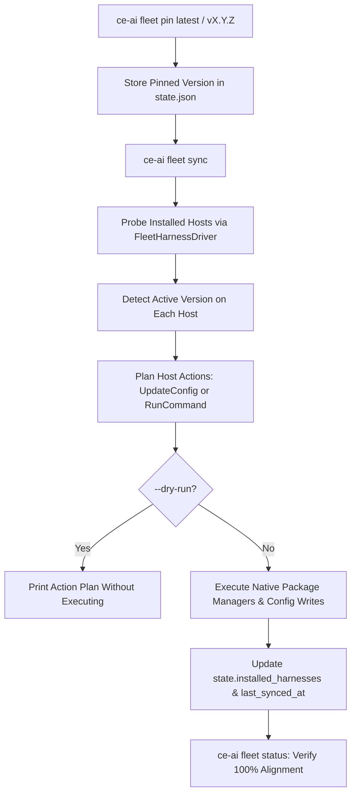
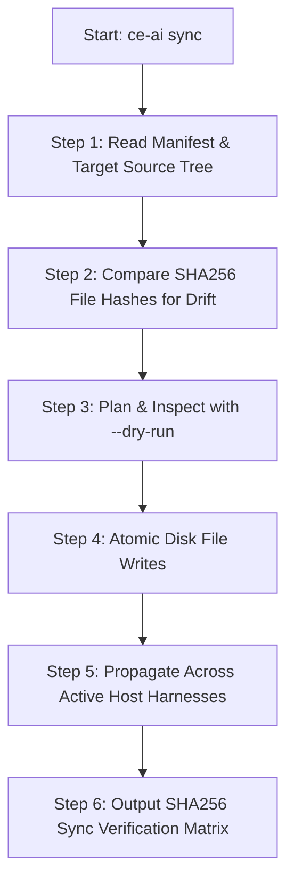
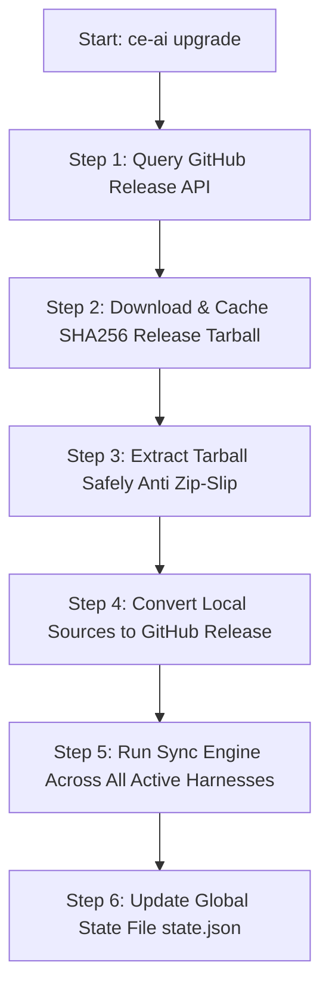

# Step-by-Step Guide: Fleet Version Governance, Sync & Upgrade Mechanisms

This guide explains how `ce-ai` manages **Fleet Version Governance** (`ce-ai fleet pin / status / sync`), project fleet maintenance (`ce-ai init-prj --all`, `ce-ai doctor --fix --all-projects`), and CLI binary self-updates.

---

## 💡 Key Concepts & Terminology (Read This First!)

Before diving into the workflows, here are simple explanations for key terms and mechanisms:

### What is Fleet Version Governance (`ce-ai fleet`)?
In multi-agent workflows, developers run different AI tools (`Claude Code`, `OpenCode`, `Pi`, `Codex`, `Cursor`). **Fleet Version Governance** provides declarative, cross-host version alignment:
- You declare a target version once (`ce-ai fleet pin latest` or `ce-ai fleet pin v3.30.5`).
- `ce-ai fleet sync` inspects all installed harnesses and drives their native package managers or config files to align them.
- `ce-ai fleet status` audits version parity and reports whether all hosts are aligned, divergent, or missing.

### What is Polymorphic Driver Orchestration?
Instead of scraping files or extracting raw tarballs into arbitrary folders, `ce-ai fleet` uses polymorphic `FleetHarnessDriver` implementations tailored to each host's native ecosystem:
- **OpenCode**: updates plugin arrays in `~/.config/opencode/opencode.json`.
- **Claude Code**: executes `claude plugin update compound-engineering@compound-engineering-plugin -y`.
- **Pi**: writes `compound_engineering_version` into `~/.pi/agent/settings.json`.
- **Codex**: writes `compound_engineering_version` into `.codex/config.json`.
- **Cursor**: writes `compound_engineering_version` into `.cursor/settings.json`.

### What is "Drift"?
**Drift** refers to any unexpected discrepancy between managed configuration/instruction blocks and expected state:
- *In projects*: If a developer or git merge alters the managed block in `AGENTS.md` or drops a session hook.
- *How it is fixed*: `ce-ai doctor --fix` (or `ce-ai init-prj --all`) repairs project-level drift across all adopted repositories.

---

## 1. Fleet Version Governance Pipeline (`ce-ai fleet`)

The `ce-ai fleet` subsystem is the primary way to maintain version parity across all installed AI coding agent hosts on your machine.

### 🛠️ Step-by-Step Fleet Workflow



#### Step 1: Pin Version (`ce-ai fleet pin`)
```bash
# Pin to the latest upstream GitHub release:
ce-ai fleet pin latest

# Or pin to an explicit release tag:
ce-ai fleet pin v3.30.5
```
Records `pinned_version` atomically in `~/.ce-ai/state.json`.

#### Step 2: Audit Alignment (`ce-ai fleet status`)
```bash
ce-ai fleet status
# Or machine-readable JSON:
ce-ai fleet status --json
```
Reports the pinned version, overall fleet alignment (`yes` / `no`), and each harness's status:
- `aligned`: active host version matches pinned version.
- `divergent`: host is on an older or different version.
- `missing`: host config or plugin is absent.

#### Step 3: Synchronize Fleet (`ce-ai fleet sync`)
```bash
# Preview actions without executing:
ce-ai fleet sync --dry-run

# Execute native updates:
ce-ai fleet sync
```
Executes each driver's planned actions, updates `state.installed_harnesses`, and records synchronization timestamps.

---

## 2. Batch Project Fleet Maintenance (`init-prj --all` & `doctor --fix`)

When you maintain multiple adopted repositories across your machine, you do not need to update each repository manually:

```bash
# Re-adopt and upgrade all registered projects in state.json in one command:
ce-ai init-prj --all

# Automatically scan all registered projects, repair drifted blocks, and restore missing hooks:
ce-ai doctor --fix --all-projects
```

---

## 3. Legacy Sync & Reconcile Mechanism (`ce-ai sync`)

> ⚠️ **Notice**: Legacy `ce-ai sync` and `ce-ai upgrade` operate via file-scraping and manifest diffing. They are retained for backward compatibility with v1 installations, but emit deprecation advisories guiding users to `ce-ai fleet pin / sync` and `ce-ai init-prj`.

The legacy `ce-ai sync` command reconciles managed file assets:



#### Step 1: Read Manifest & Target Source Tree
- **OpenCode harness is optional**: OpenCode does not need to be installed or active to use `ce-ai sync` or `ce-ai upgrade`. When only non-OpenCode harnesses (e.g. Claude Code, Copilot, Cursor, or custom plugins) are installed, `sync` reads their manifests and configuration directly and skips OpenCode mutations.
- **Standalone harness support**: Harnesses with standalone plugin directories are updated and drift-checked during `sync`.
- **Adopted and custom surface synchronization**: Any directories adopted via `ce-ai skills adopt` or configured as custom harnesses are also drift-checked and updated during sync.
- Scans skill files (`skills/`) and loaders (`plugins/compound-engineering.js`) in the resolved source.

#### Step 2: Compare SHA256 Hashes (Drift Detection)
- Computes the **SHA256** hash for each managed asset on disk and compares it against the desired source recorded in `install-manifest.json`:
  - **Copy**: If a managed file is missing on disk, it is marked to be copied.
  - **Restore**: If a file was locally modified or corrupted (drifted), it is marked for restoration.
  - **Remove**: If a file is stale or deleted in the target version, it is marked for removal.

#### Step 3: Dry-Run Inspection (`--dry-run`)
- When running `ce-ai sync --dry-run`, `ce-ai` outputs the exact planned diff actions without writing any data to disk.

#### Step 4: Safe Atomic Disk Writes
- Disk updates use the **atomic write pattern** (`write_atomic`): writes to a temporary file first and performs an atomic `rename`, ensuring system crashes or power interruptions never leave corrupt partial files on disk.

#### Step 5: Propagate Across All Active Host Harnesses
- Merges and maintains skill paths and plugin entries in the configuration of **all installed harnesses on your machine** (`opencode.json`, `claude.json`, `config.json`, `antigravity.json`, `.cursorrules`, etc.).

#### Step 6: Output SHA256 Sync Verification Matrix
- Upon completion, `ce-ai` outputs an itemized integrity verification audit table:
  ```text
  == [Sync Verification Matrix] ==
  version: compound-engineering-v3.23.3
  source: github-release
    ✓ opencode: verified — 1/1 managed files match SHA256
    ○ claude: registered — ce-ai manages no skill files here (MCP companions only; nothing to hash-verify)
    ○ pi: registered — ce-ai manages no skill files here (MCP companions only; nothing to hash-verify)
    ○ cursor: registered — config registration only — no managed assets to hash-verify

  reconciliation status: 1 verified, 9 registered (nothing to verify), 0 failed
  note: 'registered' = ce-ai wrote harness config only; it manages no files on that
        surface, so there is nothing to hash-verify. CE installed via other channels
        (plugin marketplaces, manual copies) is outside ce-ai's verification scope.
        To synchronize fleet harnesses with pinned version: ce-ai fleet sync
        (or legacy: ce-ai install --harness <name> / --harness all). Skill files
        are managed per harness only when the installed source ships a managed skills tree.
  ```
  *(Note: when OpenCode is not installed, only the active installed harnesses—such as `claude`, `cursor`, or `custom`—appear in the matrix without an OpenCode entry).*

##### Verification States

| Symbol | State | Meaning |
|---|---|---|
| `✓` | `verified` | ce-ai-managed files exist on this surface and all match their manifest SHA256. |
| `○` | `registered` | Healthy. ce-ai only wrote harness config here (MCP companions / plugin registration); it manages no files, so there is nothing to hash-verify. |
| `✗` | `FAILED` | Drift detected on ce-ai-managed files. Sync exits with code 6 (`Verification`). |

`registered` never means "broken" or "missing" — it means *ce-ai does not manage
files on that surface*. Compound Engineering installed through other channels
(for example the Claude Code plugin marketplace or manual skill copies) is real
and works, but it is outside ce-ai's verification scope.

##### How ce-ai manages each harness

| Harness | What ce-ai writes | Managed files to verify |
|---|---|---|
| `opencode` | CE plugin loader + `install-manifest.json` (SHA256 index) under `~/.config/opencode/compound-engineering/`; plugin + skills-path entries in `opencode.json` | Loader (and skills, when the source ships a managed skills tree) |
| `claude`, `codex`, `copilot`, `grok`, `kimi`, `agy`, `fx`, `pi` | MCP companion registration (`codegraph`, `engram`) in the harness config; skills copy **only** when the installed source ships a managed skills tree | Skills copy, when present |
| `cursor` | MCP registration in config only (it consumes no skills tree) | None — config registration only |
| `custom` | Files copied to your `--plugins-dir` / `--skills-dir` + manifest snapshot | All copied files |

To put a harness under ce-ai management (or re-apply it): run `ce-ai fleet sync`
(for native fleet-managed harnesses), or `ce-ai install --harness <name>`
(`--harness all` for every detected harness). After syncing, `ce-ai sync`
verifies whatever ce-ai manages on that surface.

### Canonical skills adoption (`ce-ai skills adopt`)

ce-ai harvests the release's top-level `skills/` tree as the canonical CE
skill source. If a harness skills directory already holds `ce-*` skill
folders (manual installs, older tooling), `skills adopt` puts that location
under ce-ai management instead of creating a second copy — one indexed set
per harness, always fresh, no duplicated skill descriptions in your
sessions.

```text
ce-ai skills adopt --harness opencode   # scan + confirm + adopt
ce-ai skills adopt --harness all --yes  # non-interactive
```

- **Adoptable**: `ce-*` directories whose SKILL.md frontmatter matches the
  canonical set. Adoption rewrites stale copies (each backed up first),
  completes missing canonical skills, and records the surface in the
  adoption ledger.
- **Never touched**: user-authored `ce-*` skills whose frontmatter is not in
  the canonical set, and symlinked entries.
- **Declined**: surfaces stay unmanaged and are not re-prompted until you
  re-run the command.

After adoption, `sync` keeps the surface current (manual edits are backed up
and restored as `restored-drift`), the matrix hash-verifies it as
`verified N/N`, and `skills resolve` serves its paths to any harness. The
matrix may also show `pending-adoption` (adoptable, not yet adopted —
non-interactive runs never adopt), `external-duplicate` (CE copies under
plugin caches; remove manually if unwanted), and `orphaned` (adopted root
deleted; re-adopt to restore). `ce-ai status` and `ce-ai doctor` surface
the same states.

---

## 4. Legacy Upgrade Release Mechanism (`ce-ai upgrade`)

> ⚠️ **Notice**: Legacy `ce-ai upgrade` resolves and unpacks release archives. In modern workflows, use `ce-ai fleet pin latest && ce-ai fleet sync` which drives host-native package managers directly without file-scraping.

The legacy `ce-ai upgrade` command fetches the **latest official release of the Compound Engineering Plugin published on GitHub** and updates active host harnesses.

### 🚀 Step-by-Step Upgrade Workflow



#### Step 1: Query GitHub Release API
- `ce-ai` queries GitHub API to resolve the latest release tag of `everyinc/compound-engineering-plugin` (or the specific tag supplied via `--to <tag>`).
- **Fail-loudly contract**: ce-ai only ever downloads immutable release tags. If the API is unreachable, returns an HTTP error, or answers with an unparseable payload, the command exits with code `5` (`Network`) instead of guessing. If no `compound-engineering-v*` release exists yet, it exits with code `2` (`Usage`). There is no silent fallback to a moving branch — pin a tag with `--to <tag>` or install a local tree with `--source <path>`.
- **First-time 403?** GitHub allows 60 unauth requests/hour per IP. Without a token you can hit `403 Forbidden`. Set `CE_AI_GITHUB_TOKEN` (or `GITHUB_TOKEN` / `GH_TOKEN` / `gh auth login`) to raise the limit to 5000/hour, or bypass the API with `--to <tag>` / `--source <path>`.
- See [Determinism & ce-ai Explained](determinism-explained.md) for why this matters.

#### Step 2: Download & Cache Tarball (`~/.ce-ai/cache/`)
- Downloads the official `.tar.gz` archive and computes its SHA256 digest.
- Caches the file at `~/.ce-ai/cache/ce-<sha256>.tar.gz` to enable fast offline re-installs and test runs.

#### Step 3: Zip-Slip Safe Extraction
- Inspects each entry inside the `.tar.gz` archive before unpacking.
- **Security Check**: Rejects any entry containing path traversal sequences (`../`, absolute paths `/etc/`), preventing arbitrary file overwrite attacks.

#### Step 4: Transparent Conversion from Local Sources (`source: local`)
- If a harness was previously installed from a local development tree (`dev`), `ce-ai upgrade` displays a notice:
  `notice: upgrading harnesses with local source to latest GitHub release.`
- Automatically converts the installation from local source code to the latest official stable GitHub release tag.

#### Step 5: Execute Sync Engine Across All Active Harnesses
- Triggers the `sync` engine to update skills, loaders, and configuration entries across active AI agent harnesses.

#### Step 6: Update Global State (`state.json`)
- Updates `~/.ce-ai/state.json` recording the new release tag, synchronization timestamp (`last_synced_at`), and manifest index.

---

## 📊 Modern Governance vs. Legacy Mechanisms

| Capability | 🌐 Fleet Governance (`ce-ai fleet sync`) | 📁 Batch Adoption (`ce-ai init-prj --all`) | ⚙️ Binary Update (`ce-ai self-update`) |
| :--- | :--- | :--- | :--- |
| **Scope** | Cross-host AI coding agents (`opencode`, `claude`, `pi`, `codex`, `cursor`) | Local repositories registered in `state.projects` | `ce-ai` executable binary itself |
| **Mechanism** | Drives native package managers & config files | Injects `AGENTS.md` managed blocks & session hooks | Replaces CLI executable atomically from GitHub Releases |
| **When to Use** | When upstream Compound Engineering releases an update | When updating guidelines or repairing drift across projects | When `ce-ai` ships a new CLI release |

---

## 5. CLI Binary Self-Update (`ce-ai self-update` & `ce-ai upgrade --bin`)

While `ce-ai upgrade` updates the compound-engineering plugin across harnesses, `ce-ai self-update` updates the `ce-ai` CLI binary itself.

### ⚙️ How It Works:
1. **Target Detection**: Identifies the host architecture and operating system matching the official release matrix (`x86_64-unknown-linux-gnu`, `aarch64-unknown-linux-gnu`, `x86_64-apple-darwin`, `aarch64-apple-darwin`, `x86_64-pc-windows-msvc`, `aarch64-pc-windows-msvc`).
2. **Release Resolution**: Queries `mastepanoski/ce-ai` for the latest release (or pinned `--to <tag>`) with unauthenticated web fallback to bypass API rate limits.
3. **Cryptographic Integrity**: Downloads and verifies `SHA256SUMS.txt`. If the calculated checksum of the downloaded archive mismatches, execution immediately aborts with exit code `6` (`Verification`).
4. **Safe Extraction**: Inspects archive contents (`.tar.gz` on Unix, `.zip` on Windows) to prevent Zip-Slip path traversal attacks.
5. **Atomic Replacement**:
   - **POSIX (Linux/macOS)**: Unpacks to a temporary sibling file and performs an atomic `rename(2)` over the running executable.
   - **Windows**: Renames the active `ce-ai.exe` to `ce-ai.exe.old`, swaps the new executable in place, and cleans up old files upon restart.

### 📋 Usage Examples:
```bash
# Check if a newer CLI binary is available without downloading:
ce-ai self-update --check

# Upgrade the CLI binary to the latest version:
ce-ai self-update

# Preview what would be downloaded and replaced:
ce-ai --dry-run self-update --force

# Upgrade both the plugin and the CLI binary in a single step:
ce-ai upgrade --bin
```

